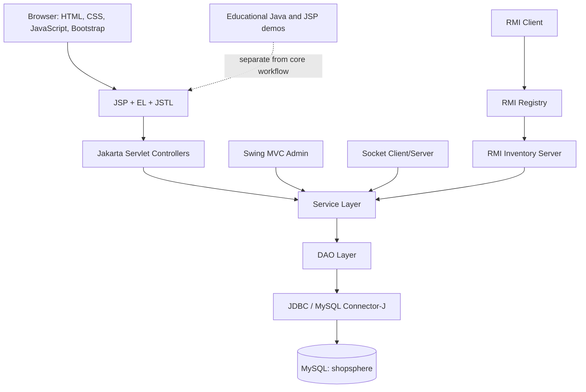
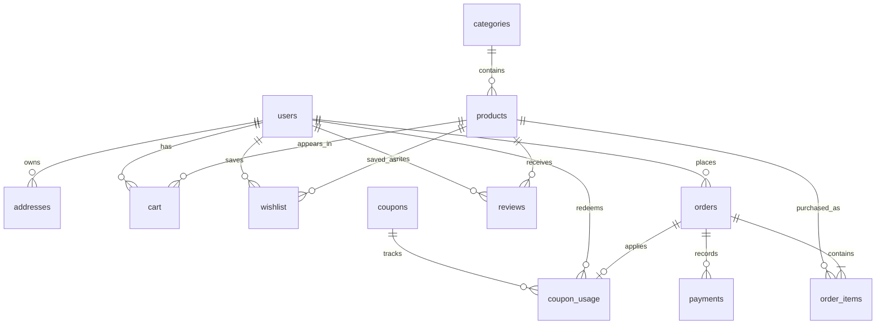
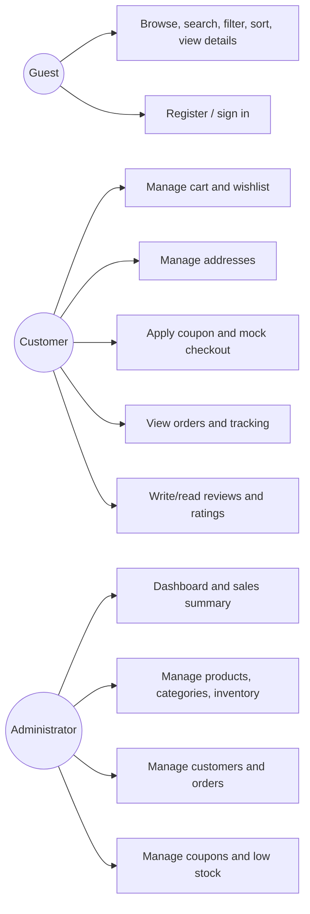
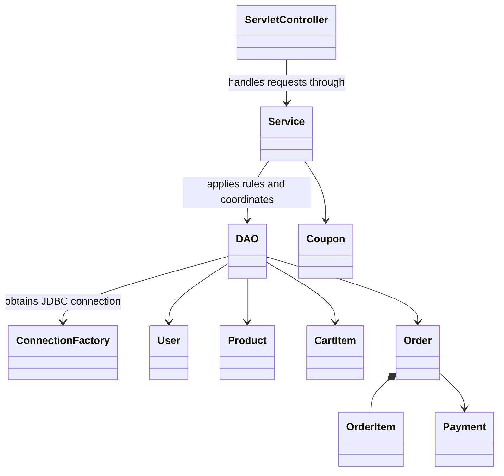
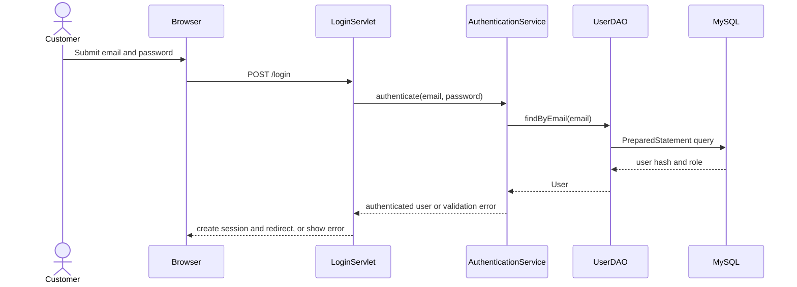

# ShopSphere Architecture and Diagrams

## Runtime Architecture



## Entity Relationships



## Use Cases



## Core Class Responsibilities



## Login Sequence



## Checkout Sequence

```mermaid
sequenceDiagram
    actor Customer
    participant Browser
    participant Servlet as CheckoutServlet
    participant Service as CheckoutService
    participant DAO as JDBC DAOs
    participant DB as MySQL
    Customer->>Browser: Confirm address, coupon, mock payment
    Browser->>Servlet: POST checkout data (no authoritative total)
    Servlet->>Service: checkout(userId, addressId, couponCode)
    Service->>DAO: begin transaction and reload cart/products
    DAO->>DB: validate stock and lock cart/product rows
    Service->>Service: calculate prices, coupon and total
    Service->>DAO: create order, items, mock payment, usage; update stock; clear cart
    DAO->>DB: commit transaction
    DB-->>Service: committed order id
    Service-->>Servlet: order result
    Servlet-->>Browser: redirect to confirmation
```
```
